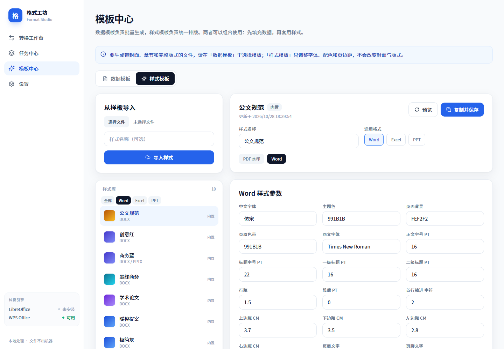
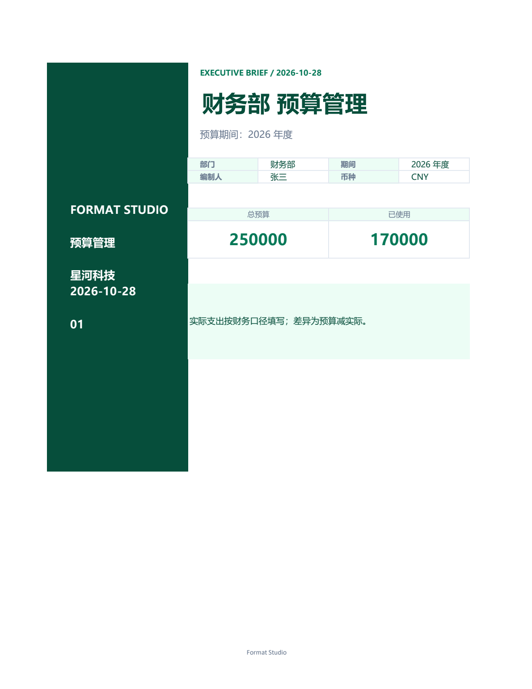
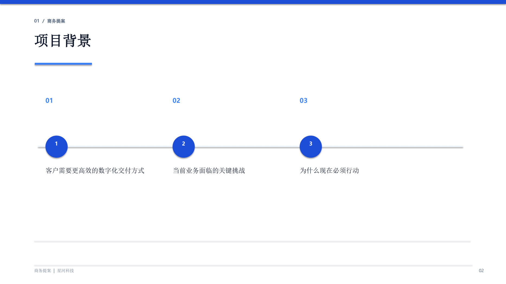

# 格式工坊 Format Studio

Windows 本地多格式转换与模板工具。文件不出机器，支持批量转换、数据模板批量生成与样式模板统一排版。

## 界面与效果

<table>
<tr>
<td width="50%"><br><sub>转换工作台</sub></td>
<td width="50%"><br><sub>数据模板中心</sub></td>
</tr>
<tr>
<td width="50%"><br><sub>样式模板</sub></td>
<td width="50%"><br><sub>任务中心</sub></td>
</tr>
<tr>
<td colspan="2"><br><sub>设置与引擎状态</sub></td>
</tr>
</table>

### 模板输出效果

<table>
<tr>
<td width="33%"><br><sub>Word · 深海蓝商务报告</sub></td>
<td width="33%"><br><sub>Excel · 墨绿预算管理</sub></td>
<td width="33%"><br><sub>PPT · 商务提案</sub></td>
</tr>
</table>


## 功能范围

- 文档组双向：TXT / Markdown / DOCX / PDF / WPS。
- 表格组双向：CSV / XLSX。
- PPTX 与 PDF 双向转换。
- 高频跨组：XLSX/CSV → PDF/DOCX/MD，DOCX 表格 → XLSX，PDF 表格 → XLSX（Beta）。
- PDF → DOCX / PPTX 双模式：可编辑（结构重排）与高保真（版面定位）。
- 数据模板：docx/xlsx/pptx + CSV/JSON/XLSX，`{{字段}}` 标量替换，一行生成一份文件。
- 样式模板：表单化编辑、从样板导入、内置预设；作用域为 docx/xlsx/pptx，PDF 支持水印。
- 本地任务队列、SSE 进度、历史记录、输出归档、诊断包。

未包含：OCR、.et/.dps、PDF 合并/拆分/压缩、PDF 表单、云同步、多用户、自动更新。

## 支持矩阵

| 源 | 目标 |
| --- | --- |
| txt | md、docx、pdf、wps |
| md | txt、docx、pdf、wps |
| docx | txt、md、pdf、wps、xlsx（表格提取） |
| pdf | txt、md、docx、pptx、wps、xlsx（表格提取，Beta） |
| wps | txt、md、docx、pdf |
| csv | xlsx、pdf、docx、md |
| xlsx | csv、pdf、docx、md |
| pptx | pdf |

其余组合在界面与 API 中明确禁用。
## 转换引擎

- 原生 Python：python-docx、openpyxl、python-pptx、pdfplumber、pypdfium2、pypdf、reportlab、markdown-it-py。
- Office → PDF：WPS COM 与 LibreOffice 双引擎，按格式与可用性路由。
- `.wps`：仅 WPS COM；检测到用户正在使用 WPS 时会拒绝转换，避免抢占会话。
- 许可策略：闭源商用友好，不使用 pdf2docx / PyMuPDF / docxtpl；LibreOffice 以 MPL-2.0 随包分发。

## 开发环境

要求 Windows 10/11 x64、Python 3.11+、Node.js 20+。

```powershell
python -m venv .venv
.\.venv\Scripts\python.exe -m pip install -r requirements.txt

cd web
npm install
npm run build
cd ..

# 开发后端（默认端口 8765）
.\.venv\Scripts\python.exe run_server.py

# 另开终端运行前端
cd web
npm run dev
```

打开 `http://127.0.0.1:5173`。开发模式默认不校验 Token；桌面模式会自动生成随机 Token。

也可直接启动桌面壳（需要 WebView2 与 pywebview）：

```powershell
.\.venv\Scripts\python.exe desktop.py
```

## 数据目录

默认 `%LOCALAPPDATA%\FormatStudio\`：

- `data.db`：任务、模板、样式、设置。
- `tasks/`：输入、输出、日志。
- `templates/`、`styles/`、`previews/`。
- `logs/app.log`：滚动日志。

默认输出目录为 `%USERPROFILE%\Documents\FormatStudio\输出`，可在设置中修改。
## 测试

```powershell
.\.venv\Scripts\python.exe -m pytest
```

测试会在临时目录创建设置，不会污染真实数据。PDF 测试使用 ReportLab 动态生成样本。

### UI 冒烟测试

先启动后端，再运行：

```powershell
.\.venv\Scripts\python.exe scripts\ui_smoke.py --url http://127.0.0.1:8765
```

脚本使用本机 Microsoft Edge（可用 `FORMAT_STUDIO_EDGE` 指定路径），覆盖上传、转换、模板页与设置页。

## 打包

1. 将 LibreOffice Portable 放到 `vendor/libreoffice/`，确保 `vendor/libreoffice/program/soffice.exe` 存在。
2. 运行：

```powershell
.\scripts\build.ps1
```

脚本会构建前端、使用 PyInstaller 生成 `dist/FormatStudio/`，若安装 Inno Setup 6 则同时生成安装包。

## 环境变量

| 变量 | 用途 |
| --- | --- |
| `FORMAT_STUDIO_DATA_DIR` | 覆盖应用数据目录 |
| `FORMAT_STUDIO_OUTPUT_DIR` | 覆盖默认输出目录 |
| `FORMAT_STUDIO_PORT` | 开发后端端口，默认 8765 |
| `FORMAT_STUDIO_TOKEN` | 本地 API Token（桌面壳自动设置） |
| `FORMAT_STUDIO_DISABLE_TOKEN=1` | 开发时关闭 Token 校验 |
| `FORMAT_STUDIO_LO_PATH` | 指定 soffice.exe |
| `FORMAT_STUDIO_WPS_PATH` | 指定 wps.exe |
## 已知限制

- 扫描版 PDF 不做 OCR；可编辑模式会返回 `NEEDS_OCR`，高保真模式保留图片版。
- PDF → Word 高保真模式使用“页面背景图 + 绝对定位文本框”，表格与矢量图保留在背景中，文字可编辑但不参与重排。
- WPS 自动化依赖本机安装与 COM 注册；WPS 正在运行时会提示先关闭文档。
- LibreOffice 未安装时，xlsx/csv → PDF 等路径不可用，但原生格式转换不受影响。
- 闭源商用请自行完成 WPS/LibreOffice 与字体的合规审查。

## 启动排障

若双击 exe 后没有窗口，请查看 `%LOCALAPPDATA%\FormatStudio\logs\startup.log`。
应用会在日志中记录后端端口、uvicorn 启动结果与 pywebview 回退原因；
缺少 WebView2 Runtime 时会尝试用系统浏览器打开界面。

## 内置模板

- 10 个 Word 数据模板：商务报告、项目周报、会议纪要、合同协议、个人简历、报价单、请假申请、PRD、培训通知、项目复盘。
- 10 个 Excel 数据模板：项目计划、预算管理、销售看板、库存管理、费用报销、报价单、考勤表、KPI 考核、客户管理、内容日历。
- 10 个 PowerPoint 数据模板：商务提案、季度汇报、产品发布、项目启动、公司介绍、培训课件、市场分析、年度总结、极简路演、团队介绍。
- 样式模板：Word / Excel / PPT 各 10 套。
- 首次启动会自动生成到「模板中心」，内置模板可直接预览、生成与套用样式，不可删除。
